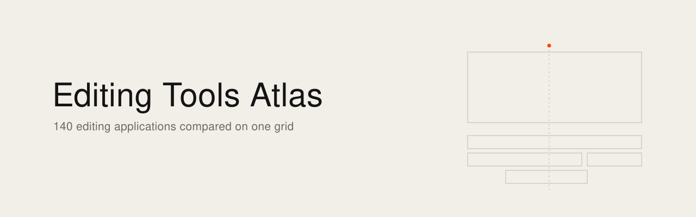
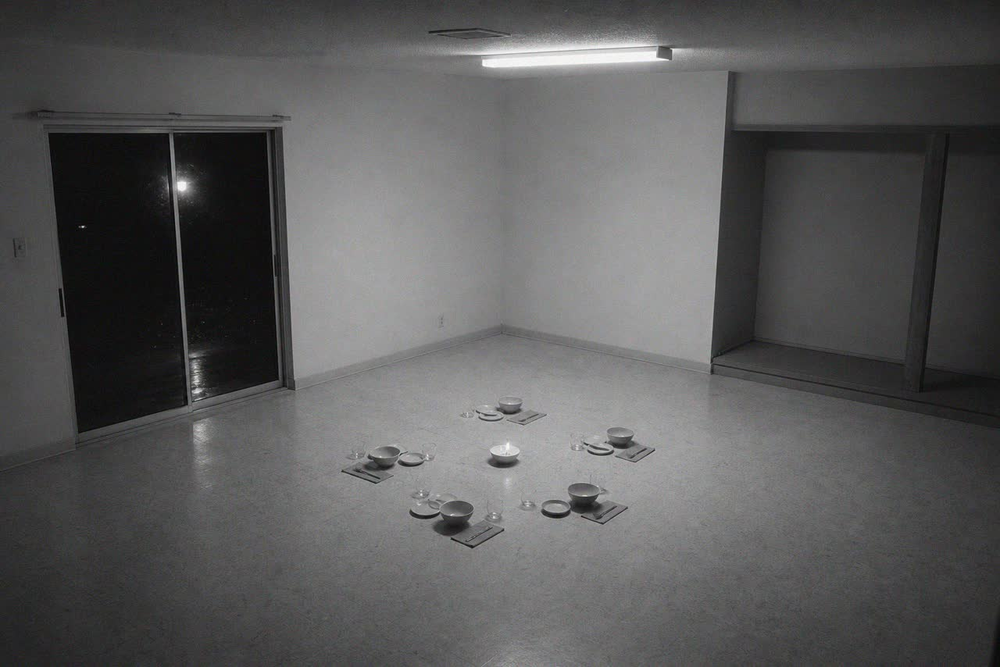

<picture><source media="(prefers-color-scheme: dark)" srcset="banner.svg"></picture>

[English](README.md) · [Français](README.fr.md)

# Atlas des logiciels de montage

Les logiciels de montage comparés sur une même grille : 140 outils, professionnels, grand public, open source, web et centrés sur l'IA. Licence, plateformes, timeline, formats d'échange, IA intégrée, pilotage par MCP et, quand ils existent, retours de monteurs cités en langue originale.



[Ouvrir l'atlas](https://ismael-joffroy-chandoutis.github.io/editing-tools-atlas/) : une seule page, sans dépendance, consultable hors ligne. [Lire la fiche des 14 logiciels suivis](https://ismael-joffroy-chandoutis.github.io/editing-tools-atlas/logiciels.html) : ce que chacun fait, ses points forts, ses limites, à qui il sert, sa licence et son prix.

C'est une grille éditoriale, faite sur des images, des documentations et des dépôts publics, datée du 7 novembre 2026. Ce n'est pas un banc d'essai. Ces outils changent vite : vérifier avant de décider.

## Comment lire

- Sept critères, notés de 0 à 3, disent à quel point un outil se rapproche des logiciels Apple et de Final Cut Pro : sobriété visuelle, densité sans bruit, clavier d'abord, fluidité, contenu au premier plan, apprentissage immédiat, magnétisme.
- Le classement mesure cette proximité, pas la qualité d'un logiciel.
- Une case vide en pointillé veut dire non évalué, jamais zéro. Le total ne compte que les critères notés, et il en faut au moins quatre pour figurer au classement.
- La fluidité n'est notée nulle part : elle ne se juge pas sur une image fixe.
- Dix interfaces ont été ouvertes dans un navigateur partagé. Leurs notes restent à revérifier, la fiche le signale, et leurs captures ne sont pas publiées.
- « Non vérifié » veut dire que rien n'a été lu de sûr sur ce point.
- Les citations de monteurs viennent d'une copie partielle de Reddit, depuis le 1er août 2025. Une moisson vide ne prouve pas l'absence de messages.

## Ce qu'il contient

- `data/nle.json` : un objet par logiciel, avec ses notes, la raison de chaque note et ses sources.
- `data/logiciels.json` : la fiche des 14 logiciels, en français et en anglais.
- `data/captures/` : 48 images publiées par les éditeurs ou les dépôts, 640 pixels au plus. Chaque fiche donne leur adresse.
- `site/` : la configuration de la page et le gabarit.
- `scripts/` : `build_site.py` construit l'atlas, `build_fiche.py` construit la fiche.
- `docs/` : les pages publiées.

```sh
python3 scripts/build_site.py scan
python3 scripts/build_site.py render
python3 scripts/build_fiche.py
```

La construction de l'atlas passe par `sips`, sur macOS, pour fabriquer les vignettes.

## Droits

Les captures montrent les logiciels d'autres sociétés. Elles servent à décrire chaque outil, en petit format. Pour en faire retirer une, ouvrez une issue : elle sera retirée. Les marques et les logos appartiennent à leurs propriétaires. Les citations restent à leurs auteurs et renvoient à leur message.

## Licence

Code sous licence MIT (`LICENSE-CODE`). Données et textes sous CC BY-SA 4.0 (`LICENSE`). Les captures, les logos et les citations ne sont pas couverts par ces licences. Le gabarit vient de [GenAI Atlas 2026](https://github.com/ismael-joffroy-chandoutis/genai-atlas-2026), sous la même licence. Atlas voisin : [Creative Canvas Atlas](https://github.com/ismael-joffroy-chandoutis/creative-canvas-atlas).

---

État vérifié au 7 novembre 2026.

Ismaël Joffroy Chandoutis, 2026. Textes sous licence [CC BY-SA 4.0](LICENSE).

Par [Ismaël Joffroy Chandoutis](https://ismaeljoffroychandoutis.com).
