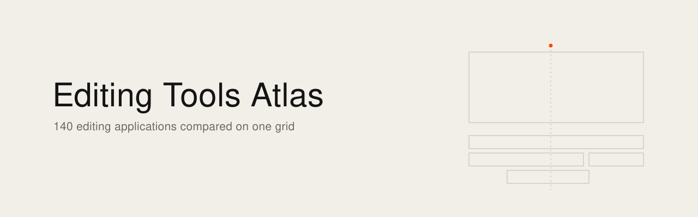
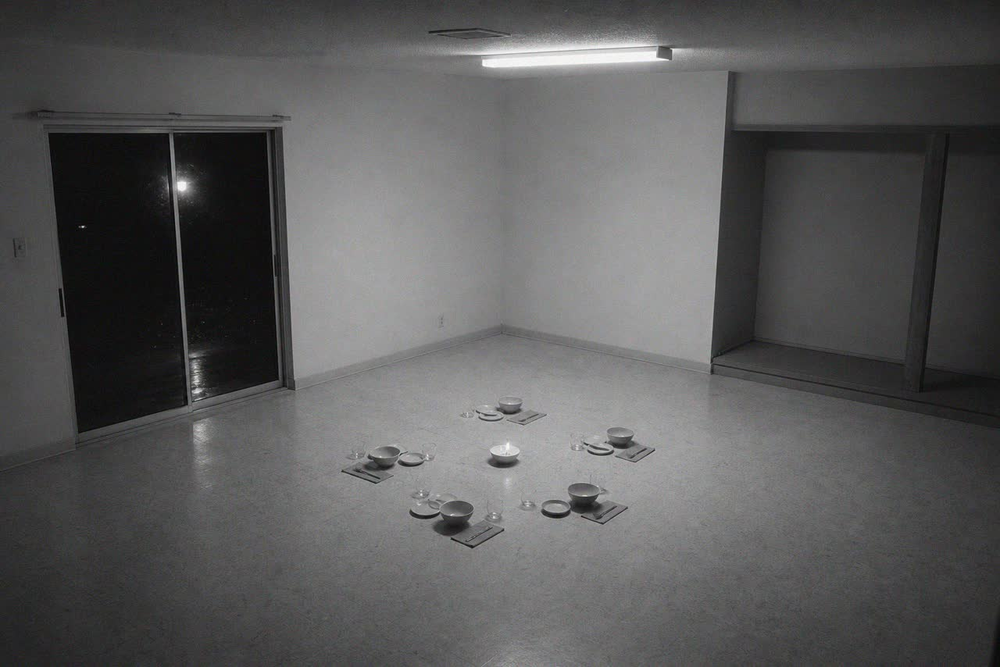

<picture><source media="(prefers-color-scheme: dark)" srcset="banner.svg"></picture>

[English](README.md) · [Français](README.fr.md)

# Editing Tools Atlas

Video editing software compared on one grid: 140 tools, professional, consumer, open source, web and AI-centred. Licence, platforms, timeline, exchange formats, built-in AI, MCP control and, where they exist, editors' comments quoted in their original language.



[Open the atlas](https://ismael-joffroy-chandoutis.github.io/editing-tools-atlas/): one page, no dependency, works offline. The page is in French. [Read the notes on 14 tracked applications](https://ismael-joffroy-chandoutis.github.io/editing-tools-atlas/software.html), in English: what each one does, strengths, limits, who it is for, licence and price.

This is an editorial grid, based on images, documentation and public repositories, dated 7 November 2026. It is not a benchmark. Tools change quickly, so check before you decide.

## How to read it

- Seven criteria, scored 0 to 3, say how close a tool comes to Apple's software and Final Cut Pro: visual restraint, density without noise, keyboard first, fluidity, content in front, immediate learning, magnetism.
- The ranking measures that closeness, not the quality of the software.
- An empty dotted cell means not assessed, never zero. The total counts only scored criteria, and a tool needs at least four to enter the ranking.
- Fluidity is scored nowhere: a still image cannot show it.
- Ten interfaces were opened in a shared browser. Their scores still need checking, the entry says so, and their screenshots are not published.
- "Non vérifié" means nothing reliable was read on that point.
- Editors' quotes come from a partial copy of Reddit, since 1 August 2025. An empty result does not prove there were no posts.

## What it contains

- `data/nle.json`: one object per application, with its scores, the reason for each score and its sources.
- `data/logiciels.json`: the notes on 14 applications, in French and English.
- `data/captures/`: 48 images published by the vendors or repositories, 640 pixels at most. Each entry gives their address.
- `site/`: the page configuration and the template.
- `scripts/`: `build_site.py` builds the atlas, `build_fiche.py` builds the notes.
- `docs/`: the published pages.

```sh
python3 scripts/build_site.py scan
python3 scripts/build_site.py render
python3 scripts/build_fiche.py
```

Building the atlas uses `sips`, on macOS, to make the thumbnails.

## Rights

Screenshots show other companies' software. They describe each tool at a small size. To have one removed, open an issue and it will be removed. Trademarks and logos belong to their owners. Quotes remain their authors' and link to the original post.

## Licence

Code under the MIT licence (`LICENSE-CODE`). Data and texts under CC BY-SA 4.0 (`LICENSE`). Screenshots, logos and quotes are not covered by these licences. The template comes from [GenAI Atlas 2026](https://github.com/ismael-joffroy-chandoutis/genai-atlas-2026), under the same licence. Related atlas: [Creative Canvas Atlas](https://github.com/ismael-joffroy-chandoutis/creative-canvas-atlas).

---

State verified on 7 November 2026.

Ismaël Joffroy Chandoutis, 2026. Texts under a [CC BY-SA 4.0](LICENSE) license.

By [Ismaël Joffroy Chandoutis](https://ismaeljoffroychandoutis.com).
